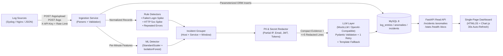
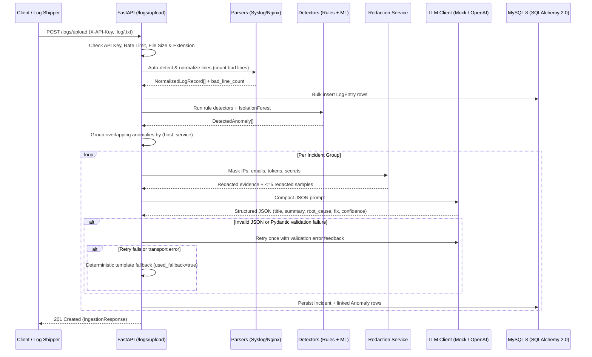

# NetLog AI — System Architecture

## High-Level Overview

NetLog AI is a modular, production-style observability backend that ingests raw network and server
logs (syslog, Nginx access logs, or structured JSON), detects anomalies using a hybrid rule + ML
engine, redacts sensitive fields before calling a provider-agnostic LLM layer, and exposes both a
REST API and an auto-refreshing operational dashboard.

## Request & Incident Summarization Sequence

## Module Breakdown

| Module | Responsibility |
| --- | --- |
| `app/config.py` | Environment-driven `pydantic-settings` configuration; zero secrets in code. |
| `app/database.py` & `app/models.py` | SQLAlchemy 2.0 ORM (`LogEntry`, `Anomaly`, `Incident`) with composite time-series indexes and Alembic migrations (`alembic/`). |
| `app/parsers/` | `BaseParser`, `SyslogParser` (RFC 3164 + ISO-8601), `NginxParser` (combined + extended latency/host/service), and auto-detection with safe bad-line accounting. |
| `app/detectors/` | Modular rule detectors (`FailedLoginSpikeDetector`, `Http5xxSpikeDetector`, `RepeatedErrorDetector`) and `IsolationForestDetector` fitted on baseline per-minute telemetry (`request_count`, `error_rate`, `mean_latency_ms`, `p95_latency_ms`). |
| `app/services/redaction.py` | Masks IPv4/IPv6 host octets (`203.0.xxx.xxx`), emails, JWTs, Bearer tokens, API keys, and key-value secrets before LLM prompts or anomaly storage. |
| `app/llm/` | Provider-agnostic `BaseLLMClient`, zero-key `MockLLMClient`, `OpenAICompatibleLLMClient`, compact prompt builders, Pydantic v2 validation, single retry, and template fallback. |
| `app/services/incidents.py` | Anomaly grouping, deduplication, AI summarization persistence, paginated filtering, and per-minute chart aggregation. |
| `app/api/` | FastAPI routers for health, ingestion, incidents, anomalies, stats, and on-demand analysis with `X-API-Key` auth and sliding-window upload rate limiting. |
| `app/static/` | Dependency-free single-page HTML/CSS/JS dashboard with Chart.js dual-axis error/latency charts and 30-second auto-refresh. |

## Security & Reliability Guardrails

- **Parameterized queries only**: All database access uses SQLAlchemy 2.0 ORM expressions and bound parameters.
- **Write protection**: `POST /logs/upload`, `POST /logs`, `POST /analyze`, and `PATCH /incidents/{id}/status` enforce constant-time `X-API-Key` validation.
- **Abuse controls**: Upload size is capped (`MAX_UPLOAD_SIZE_BYTES`), extensions are restricted (`.log`, `.txt`), and `/logs/upload` enforces per-client sliding-window rate limits (`429 Too Many Requests` + `Retry-After`).
- **Privacy boundary**: Full raw log payloads are never sent to external LLMs; only aggregated counts/metrics and up to 5 redacted lines cross the LLM boundary.
- **Graceful degradation**: Malformed log lines never abort ingestion; LLM failures or malformed JSON fall back deterministically to a template incident summary.
